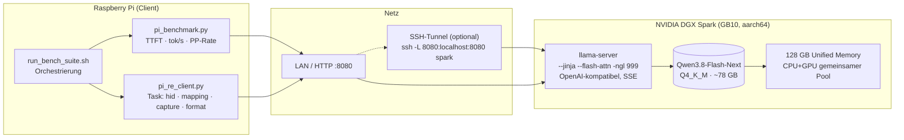
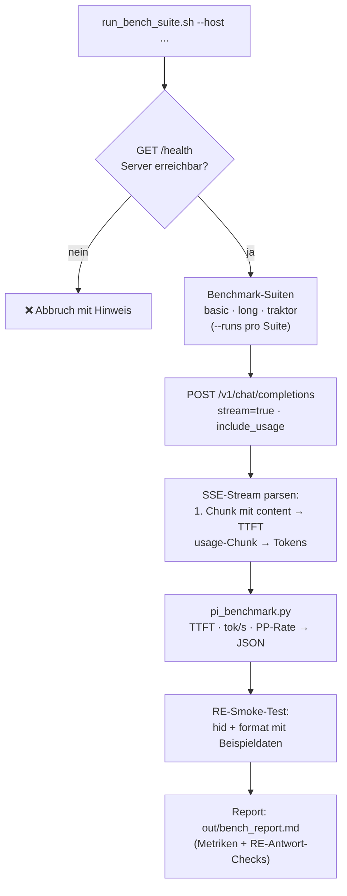
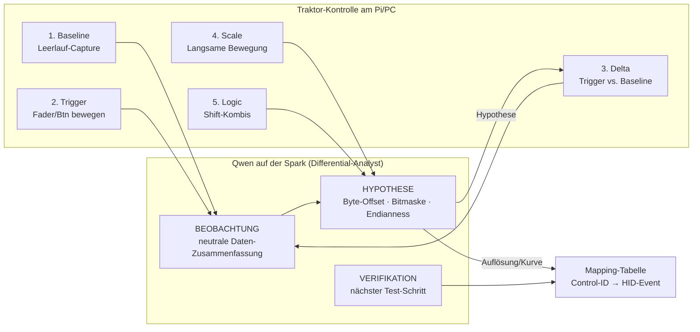

# Architektur: qwen-flash-spark

Drei Sichten auf das System. Alle Diagramme in Mermaid (renderbar in GitHub/Obsidian/VS Code).

## 1. Deployment: Pi ↔ Spark

**Punkte:** Der Pi führt **keine Inferenz** aus — er baut nur Prompts, parst SSE-Streams und schreibt Reports. Der SSH-Tunnel ist die sichere Variante (lokal weitergereichter Port statt offenem 0.0.0.0).

## 2. Benchmark-Flow

**Metrik-Definitionen:**
- **TTFT** (Time To First Token): Zeit vom Request bis zum ersten Content-Chunk.
- **tok/s** (Generation): `completion_tokens / (total_time - ttft)`.
- **PP-Rate** (Prompt Processing): `prompt_tokens / ttft` — Näherung; exakte Prefill-Zeit liefert llama-servers Usage-Feld nicht, daher als Schätzung kennzeichnen.

## 3. RE-Differential-Workflow (Traktor)

**Loop-Prinzip:** Jede LLM-Hypothese erzeugt den nächsten physischen Test am Gerät (Capture → Prompt → Hypothese → Capture …). Der Client erzwingt die Struktur BEOBACHTUNG/HYPOTHESE/VERIFIKATION über den System-Prompt in `pi_re_client.py`; Unsicherheiten sind mit `[UNSICHER]` zu markieren. Rechtsrahmen: § 40e UrhG (Interoperabilität) — siehe `TRAKTOR_RE_RESEARCH.md` Abschnitt 6.
