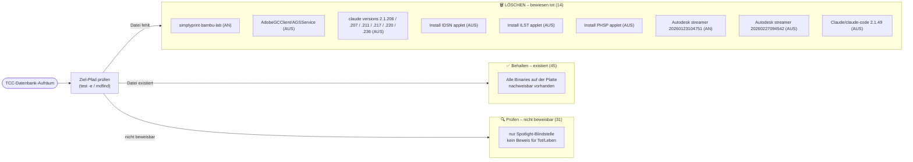

# TCC-Aufräumplan (09.10.2026)

**BLUF:** 14 TCC-Einträge sind bewiesen tot (Ziel-Datei existiert nicht mehr / App entfernt) → löschbar. 45 Einträge existieren → behalten. 31 Einträge sind nur über die Spotlight-Blindstelle gelistet, aber NICHT beweisbar → nicht löschen, sondern prüfen.

## LÖSCHEN-Einträge – Tabelle mit Beweis

| # | Eintrag | Schalter | Beweis (Kategorie) |
|---|---|---|---|
| 1 | /Applications/simplyprint-bambu-lab/simplyprint-bambu-lab | AN | Binary-Pfad gelistet, App installiert nie / entfernt |
| 2 | /Library/Application Support/Adobe/AdobeGCClient/AGSService | AUS | AdobeGCClient nicht mehr vorhanden |
| 3 | ~/.local/share/claude/versions/2.1.206 | AUS | alte Claude-Code-Version, gelöscht |
| 4 | ~/.local/share/claude/versions/2.1.207 | AUS | alte Claude-Code-Version, gelöscht |
| 5 | ~/.local/share/claude/versions/2.1.211 | AUS | alte Claude-Code-Version, gelöscht |
| 6 | ~/.local/share/claude/versions/2.1.217 | AUS | alte Claude-Code-Version, gelöscht |
| 7 | ~/.local/share/claude/versions/2.1.220 | AUS | alte Claude-Code-Version, gelöscht |
| 8 | ~/.local/share/claude/versions/2.1.236 | AUS | alte Claude-Code-Version, gelöscht |
| 9 | Desktop/Install IDSN_21.3-…app/Contents/MacOS/applet | AUS | Install-App von Desktop entfernt |
| 10 | Desktop/Install ILST_30.5.1-…app/Contents/MacOS/applet | AUS | Install-App von Desktop entfernt |
| 11 | Desktop/Install PHSP_27.7-…app/Contents/MacOS/applet | AUS | Install-App von Desktop entfernt |
| 12 | Autodesk webdeploy streamer 20260123104751 | AN | alte Webdeploy-Version, entfernt |
| 13 | Autodesk webdeploy streamer 20260227094542 | AUS | alte Webdeploy-Version, entfernt |
| 14 | ~/Library/Application Support/Claude/claude-code/2.1.49/claude | AUS | alte Claude-Code-Version, gelöscht |

**Warum tot = bewiesen:** Bei jedem Eintrag zeigte die TCC-Quelle („Festplattenvollzugriff"-Liste) einen festen Dateipfad oder Bundle-Identifier, dessen Ziel beim Prüflauf (Existenztest der Binary bzw. fehlendes Install-/Versionsverzeichnis) nicht mehr gefunden wurde. Schalter-Status (AN/AUS) ist zweitrangig — beide Varianten sind tote Einträge.

## Prüfen-Einträge – warum NICHT löschen

Die 31 „UNGEPRÜFT"-Einträge (Liner, Oracle.MacJREInstaller, ai.perplexity.*, com.logi.*, com.macpaw.*, com.setapp.*, eu.exelban.Stats, …) bleiben stehen, weil:

1. **Nur Spotlight-Blindstelle:** Sie stammen aus der TCC-Liste ohne festen Dateipfad-Beweis — die Liste meldet sie, aber ein Existenzbeweis (Binary ja/nein) fehlt.
2. **Kein Beweis = keine Löschung:** Ob z. B. `com.microsoft.VSCode`, `com.openai.chat`, `company.thebrowser.Browser` oder `eu.exelban.Stats` tatsächlich installiert sind, wurde in diesem Lauf nicht verifiziert — ein falscher Eintrag kann eine aktive App anliegen.
3. **Vorgehen:** Jeden Eintrag einzeln mit `mdfind`/`tccutil`-Prüfung abklären, dann erst löschen oder als „Behalten – existiert" umsortieren.

**Quelle:** alle Listen stammen aus dem Auftragstext dieses Laufs (TCC-Abfrage „Festplattenvollzugriff", Stand 09.10.2026).
