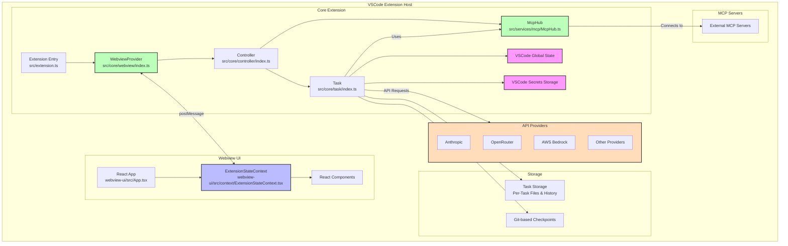

# cline (cline-code)

Zuletzt gespiegelt: 2026-09-23 15:22 UTC

## bun-and-node

# Bun (tooling) and Node (runtime)

This repo uses **bun** for package management and task running, and **Node** as
the execution runtime. Both are correct at the same time; the distinction is the
source of most confusion, so keep it straight before editing scripts, configs,
docs, or comments.

## Use bun for tooling

- `bun install` (never `npm install` / `npm ci`)
- `bun run <script>` (never `npm run <script>`)
- `bunx <bin>` (never `npx <bin>`)
- `bun <file>.ts` to run a TS entrypoint directly (no `ts-node` / `tsx`)
- `bun esbuild.mjs` to drive the build (esbuild/vite are still the bundlers)
- `bun run --parallel ...` for parallel tasks

The root `bun.lock` is the single lockfile for the whole workspace, including
`apps/vscode`, `webview-ui`, and `testing-platform`. There are no per-package npm
lockfiles.

## Node is the runtime — do NOT rewrite these to bun

The build product runs on Node: the VS Code extension host loads
`dist/extension.js` as CommonJS under Node, and the standalone `cline-core` is a
Node process. The following are Node runtime/ABI references and are correct as-is:

| Reference | Why it is Node |
|-----------|----------------|
| esbuild `platform: "node"` / `target: "node..."` | The bundle targets the Node runtime (extension host, standalone core). |
| `TARGET_NODE_VERSION` (`scripts/package-standalone.mjs`) | Pins the Node ABI of the bundled standalone runtime (matches the JetBrains-packaged Node). |
| `prebuild-install --target=<node version>` | Downloads native `.node` binaries for that Node ABI. |
| `NODE_PATH=... node cline-core.js` | The standalone core is launched by Node, not bun. |
| `node:` import specifiers (e.g. `node:fs`) | Node builtin module scheme; unrelated to tooling. |
| `process.versions.node`, `engines.node`, `@types/node` | Runtime version probe / declared runtime / its types. |
| `ELECTRON_RUN_AS_NODE` | VS Code/Electron runs the extension host as Node. |

When a file legitimately uses both bun and node (e.g. `package-standalone.mjs`
does `bun install` but `prebuild-install --target=<node>`), the `node` token is
the runtime/ABI target, not tooling. If unsure, leave it.

## Tests: bun vs the VS Code host

A test file's runner is decided by its import:

- **`import ... from "bun:test"`** → runs under `bun test` (the node-side unit
  suites + the SDK/model-catalog suites). `scripts/run-bun-unit-tests.ts`
  discovers these by the `bun:test` import and runs one isolated bun process per
  file. `build-tests.js` excludes them from the integration compile so the
  `bun:test` builtin never reaches Node.
- **`import ... from "mocha"`** → runs under `@vscode/test-cli` in a real VS Code
  extension host (Node). These exercise the live `vscode` API and cannot run
  under bun.

So a file imports `bun:test` XOR `mocha`. Don't add `bun:test` to a test that
needs the real extension host.

## cline-overview

# Cline Extension Architecture & Development Guide

## Project Overview

Cline is a VSCode extension that provides AI assistance through a combination of a core extension backend and a React-based webview frontend. The extension is built with TypeScript and follows a modular architecture pattern.

## Architecture Overview



## Definitions 

- **Core Extension**: Anything inside the src folder, organized into modular components
- **Core Extension State**: Managed by the Controller class in src/core/controller/index.ts, which serves as the single source of truth for the extension's state. It manages multiple types of persistent storage (global state, workspace state, and secrets), handles state distribution to both the core extension and webview components, and coordinates state across multiple extension instances. This includes managing API configurations, task history, settings, and MCP configurations.
- **Webview**: Anything inside the webview-ui. All the react or view's seen by the user and user interaction components
- **Webview State**: Managed by ExtensionStateContext in webview-ui/src/context/ExtensionStateContext.tsx, which provides React components with access to the extension's state through a context provider pattern. It maintains local state for UI components, handles real-time updates through message events, manages partial message updates, and provides methods for state modifications. The context includes extension version, messages, task history, theme, API configurations, MCP servers, marketplace catalog, and workspace file paths. It synchronizes with the core extension through VSCode's message passing system and provides type-safe access to state through a custom hook (useExtensionState).

### Core Extension Architecture

The core extension follows a clear hierarchical structure:

1. **WebviewProvider** (src/core/webview/index.ts): Manages the webview lifecycle and communication
2. **Controller** (src/core/controller/index.ts): Handles webview messages and task management
3. **Task** (src/core/task/index.ts): Executes API requests and tool operations

This architecture provides clear separation of concerns:
- WebviewProvider focuses on VSCode webview integration
- Controller manages state and coordinates tasks
- Task handles the execution of AI requests and tool operations

### WebviewProvider Implementation

The WebviewProvider class in `src/core/webview/index.ts` is responsible for:

- Managing multiple active instances through a static set (`activeInstances`)
- Handling webview lifecycle events (creation, visibility changes, disposal)
- Implementing HTML content generation with proper CSP headers
- Supporting Hot Module Replacement (HMR) for development
- Setting up message listeners between the webview and extension

The WebviewProvider maintains a reference to the Controller and delegates message handling to it. It also handles the creation of both sidebar and tab panel webviews, allowing Cline to be used in different contexts within VSCode.

### Core Extension State

The `Controller` class manages multiple types of persistent storage:

- **Global State:** Stored across all VSCode instances. Used for settings and data that should persist globally.
- **Workspace State:** Specific to the current workspace. Used for task-specific data and settings.
- **Secrets:** Secure storage for sensitive information like API keys.

The `Controller` handles the distribution of state to both the core extension and webview components. It also coordinates state across multiple extension instances, ensuring consistency.

State synchronization between instances is handled through:
- File-based storage for task history and conversation data
- VSCode's global state API for settings and configuration
- Secrets storage for sensitive information
- Event listeners for file changes and configuration updates


## debug-harness

# Debug Harness

HTTP-controlled debugger for the VSCode extension at `src/dev/debug-harness/server.ts`.

## Quick start

```bash
# Build extension first if needed (protos + esbuild):
bun run protos && IS_DEV=true bun esbuild.mjs

# Launch (skip-build if already built). Run with node, NOT bun — Playwright's
# Electron launch times out under bun:
node src/dev/debug-harness/server.ts --skip-build --auto-launch

# In another terminal:
curl localhost:19229/api -d '{"method":"status"}'
```

## Data Isolation

The debugee runs with `CLINE_DIR=~/.cline2` by default, separate from your real `~/.cline`.
This prevents the debugee's logout from logging out the debugger, and vice versa.
Override with `--cline-dir /tmp/test-dir`. Check with `status()` → `clineDir`.

## Browser Capture & OAuth

The debugee runs with `CLINE_CAPTURE_BROWSER=1`, which intercepts `openExternal()` in
`src/utils/env.ts`. URLs are captured instead of opening a real browser:

- Logged to `$CLINE_DIR/data/debug-captured-urls.jsonl`
- POSTed in real-time to `/captured-url` on the harness server
- Queryable via `oauth.captured_urls`

### OAuth API

- **`oauth.captured_urls`** `{clear?}` — URLs the debugee tried to open
- **`oauth.read_stored_token`** — Check auth token presence in secrets.json
- **`oauth.simulate_callback`** `{path, code?, state?, provider?, token?}` — Build vscode:// callback URI
- **`oauth.read_captured_urls_file`** — Read on-disk JSONL of captured URLs

### OAuth testing flow

For **Cline OAuth** (SDK local callback): The SDK starts a local HTTP server, the auth URL
is captured. To complete: open the captured URL in a real browser (it redirects back to the
SDK's callback server), OR extract the callback port and `curl http://127.0.0.1:PORT/callback?code=...`.

For **MCP/Provider OAuth** (vscode:// URI): The redirect goes to a vscode:// URI.
`oauth.simulate_callback` only *builds* the URI — it does not deliver it, and the ESM
extension host can't `require()` the handler. To actually deliver the callback, call the
debug-only hook via `ext.evaluate` (with `awaitPromise: true`):
`globalThis.__clineHandleUri("vscode://saoudrizwan.claude-dev/...?code=...&state=...")`.
It runs the same `SharedUriHandler.handleUri` as VSCode's real URI handler and exists only
when `CLINE_CAPTURE_BROWSER` is set (the harness always sets it; never ships in prod).
For end-to-end MCP OAuth, get a real `code` from the local MCP OAuth test server
(`bun run dev:mcp-oauth-test-server`).

## Navigating Views — Use Commands, Not Clicks

Don't try to find/click small sidebar icons. Use VSCode commands via command palette.
Registered in `src/registry.ts`:

| Command | View |
|---------|------|
| `cline.accountButtonClicked` | Account / sign-in |
| `cline.historyButtonClicked` | Task history |
| `cline.settingsButtonClicked` | Settings |
| `cline.mcpButtonClicked` | MCP servers |
| `cline.plusButtonClicked` | New task (chat) |
| `cline.worktreesButtonClicked` | Worktrees |

```bash
curl localhost:19229/api -d '{"method":"ui.command_palette","params":{"command":"cline.accountButtonClicked"}}'
```

## Key commands

All via `POST localhost:19229/api` with `{"method":"...", "params":{...}}`:

- **`launch`** / **`shutdown`** — lifecycle
- **`ui.screenshot`** — screenshot to `/tmp/cline-debug/`; returns `{path}` — **use `read_file` on the path to examine, do NOT `open` the file** (Preview.app covers the VSCode window)
- **`ui.open_sidebar`** — open the Cline sidebar
- **`ext.set_breakpoint`** `{file, line, condition?}` — breakpoint by source file (sourcemap-resolved)
- **`ext.evaluate`** `{expression, callFrameId?}` — eval in extension host
- **`ext.resume`** / **`ext.step_over`** / **`ext.step_into`** — stepping
- **`ext.call_stack`** — inspect when paused
- **`web.evaluate`** `{expression}` — eval in webview
- **`web.post_message`** `{message}` — send postMessage to extension host via exposed vsCodeApi
- **`wait_for_pause`** `{timeout?}` — block until breakpoint hit
- **`ui.locator`** `{role?, testId?, text?, frame?}` — Playwright locator (auto-retries on stale sidebar frame)
- **`ui.react_input`** `{text, selector?, clear?, submit?}` — set React textarea value via `execCommand('insertText')`; works reliably across multiple tasks
- **`ui.send_message`** `{text, images?, files?, responseType?}` — send chat message bypassing the textarea entirely (via gRPC postMessage)
- **`ui.command_palette`** `{command}` — run VSCode command

## Typical Session

```bash
# 1. Launch
curl localhost:19229/api -d '{"method":"launch","params":{"skipBuild":true}}'

# 2. Open sidebar + dismiss overlays (ALWAYS do this first)
curl localhost:19229/api -d '{"method":"ui.open_sidebar"}'
curl localhost:19229/api -d '{"method":"web.evaluate","params":{"expression":"document.querySelectorAll(\".sr-only\").forEach(el => el.parentElement?.click())"}}'

# 3. Navigate to view
curl localhost:19229/api -d '{"method":"ui.command_palette","params":{"command":"cline.accountButtonClicked"}}'

# 4. Check captured OAuth URLs if testing auth
curl localhost:19229/api -d '{"method":"oauth.captured_urls"}'

# 5. Verify
curl localhost:19229/api -d '{"method":"ui.screenshot"}'
```

## Caveats

- **⚠️ Dismiss promotional overlays FIRST**: On fresh launches, full-screen promo overlays block the sidebar. **Dismiss immediately after `ui.open_sidebar`**, before any other interaction or screenshot. May need to run twice:
  ```bash
  curl localhost:19229/api -d '{"method": "ui.open_sidebar"}'
  curl localhost:19229/api -d '{"method": "web.evaluate", "params": {"expression": "document.querySelectorAll(\".sr-only\").forEach(el => el.parentElement?.click())"}}'
  ```

## general

This file is the secret sauce for working effectively in this codebase. It captures tribal knowledge—the nuanced, non-obvious patterns that make the difference between a quick fix and hours of back-and-forth & human intervention.

**When to add to this file:**
- User had to intervene, correct, or hand-hold
- Multiple back-and-forth attempts were needed to get something working
- You discovered something that required reading many files to understand
- A change touched files you wouldn't have guessed
- Something worked differently than you expected
- User explicitly asks to "add this to CLAUDE.md"

**Proactively suggest additions** when any of the above happen—don't wait to be asked.

**What NOT to add:** Stuff you can figure out from reading a few files, obvious patterns, or standard practices. This file should be high-signal, not comprehensive.

## Miscellaneous
- The whole repo (including `apps/vscode`) uses **bun** for package management and task running. Emit `bun run X` / `bun install` / `bunx <bin>` / `bun file.ts`, never npm/npx. Node remains the *runtime* (VS Code's extension host and the standalone cline-core are Node), so Node-runtime tokens are legitimate and must not be "fixed" to bun — see @.clinerules/bun-and-node.md for the keep-list vs rewrite-list.
- Avoid provider-specific string matching / hardcoded provider branches when fixing provider/config plumbing. Prefer provider metadata, shared catalog/defaults, explicit protocol/client capabilities, or centralized normalization utilities that apply by data shape rather than `providerId === "..."`. If a provider exception seems necessary, stop and explain why instead of adding ad-hoc string matching.
- This is a VS Code extension—check `package.json` for available scripts before trying to verify builds (e.g., `bun run compile`, not `bun run build`).
- When reading a configuration files that users may edit, use `readFileStrippingUtf8Bom`, `readFileSyncStrippingUtf8Bom`, or `stripUtf8Bom` from `@cline/shared/node`. DON'T strip byte order marks of user files handled by tools/passed to models.
- When creating PRs, contributors should not create changelog-entry files. Maintainers handle release versioning and changelog curation during the release process.
- When adding new feature flags, see this PR as a reference https://github.com/cline/cline/pull/7566
- Additional instructions about making requests: @.clinerules/network.md

## Searching the Codebase — Avoiding Build Output

Several directories contain build output or generated code that produces
noisy or unusable results with `search_files` / `grep`:

| Directory | What it is | Why it's a problem |
|-----------|-----------|-------------------|
| `out/` | esbuild bundle output | Mirrors `src/` structure as minified JS — every search gets duplicate hits on single-line files |
| `dist/` | Packaged extension | Entire extension bundled into one minified `extension.js` (~1 long line) |
| `dist-standalone/` | Standalone build output | Same minification issue |
| `src/generated/` | Generated protobuf code | Auto-generated from `proto/`; not the source of truth |
| `src/shared/proto/` | Generated proto type defs | Auto-generated from `proto/`; not the source of truth |
| `node_modules/` | Dependencies | Huge, not project source |

### How to skip build output

**`search_files`** — Point at `src/` (not the project root) and use `file_pattern`:
```
search_files(path="src/core", regex="myFunction", file_pattern="*.ts")
```
The `file_pattern` parameter is the most effective filter — e.g. `"*.ts"`,
`"*.tsx"`, `"*.proto"`.

**`grep` directly** — Exclude build dirs and restrict to source extensions:
```bash
grep -rn "myFunction" src/ --include="*.ts" --exclude-dir={out,dist,node_modules,generated}
```

### When you must search minified files

Sometimes you need to verify what got bundled (e.g., checking if a change
made it into the build). Minified files are typically one long line, so
normal `grep` shows the entire file as context. Use these approaches:

- **`grep -oP`** to extract just the match with limited surrounding context:
  ```bash
  grep -oP '.{0,40}myFunction.{0,40}' dist/extension.js
  ```
- **`read_file`** on files in `out/src/` — these have source maps and are
  more readable than `dist/extension.js` (which is the fully bundled output).
- **Source maps** — `out/src/*.js.map` and `dist/extension.js.map` can be
  used to trace minified output back to original source locations.

## gRPC/Protobuf Communication
The extension and webview communicate via gRPC-like protocol over VS Code message passing.

**Proto files live in `proto/`** (e.g., `proto/cline/task.proto`, `proto/cline/ui.proto`)
- Each feature domain has its own `.proto` file
- For simple data, use shared types in `proto/cline/common.proto` (`StringRequest`, `Empty`, `Int64Request`)
- For complex data, define custom messages in the feature's `.proto` file
- Naming: Services `PascalCaseService`, RPCs `camelCase`, Messages `PascalCase`
- For streaming responses, use `stream` keyword (see `subscribeToAuthCallback` in `account.proto`)

**Run `bun run protos`** after any proto changes—generates types in:
- `src/shared/proto/` - Shared type definitions
- `src/generated/grpc-js/` - Service implementations
- `src/generated/nice-grpc/` - Promise-based clients
- `src/generated/hosts/` - Generated handlers

**Adding new enum values** (like a new `ClineSay` type) requires updating conversion mappings in `src/shared/proto-conversions/cline-message.ts`

**Adding new RPC methods** requires:
- Handler in `src/core/controller/<domain>/`
- Call from webview via generated client: `UiServiceClient.scrollToSettings(StringRequest.create({ value: "browser" }))`

**Example—the `explain-changes` feature touched:**
- `proto/cline/task.proto` - Added `ExplainChangesRequest` message and `explainChanges` RPC
- `proto/cline/ui.proto` - Added `GENERATE_EXPLANATION = 29` to `ClineSay` enum
- `src/shared/ExtensionMessage.ts` - Added `ClineSayGenerateExplanation` type
- `src/shared/proto-conversions/cline-message.ts` - Added mapping for new say type
- `src/core/controller/task/explainChanges.ts` - Handler implementation
- `webview-ui/src/components/chat/ChatRow.tsx` - UI rendering

## Adding New Global State Keys
Adding a new key to global state requires updates in multiple places. Missing any step causes silent failures.

Required steps:
1. Type definition in `src/shared/storage/state-keys.ts` - Add to `GlobalState` or `Settings` interface
2. Add any default value or transform in `src/shared/storage/state-keys.ts` if the key needs one
3. Read and write the value through `StateManager` (`setGlobalState()` / `getGlobalStateKey()`) after initialization

Persistent state is file-backed through `StateManager`; do not add new runtime reads or writes against VS Code `ExtensionContext` storage. That storage is only a legacy migration source.

Settings plumbing gotcha: if a key is user-toggleable from settings, wire both controller update paths:
- `src/core/controller/state/updateSettings.ts` for webview `updateSetting(...)`
- `src/core/controller/state/updateSettingsCli.ts` for CLI/ACP settings updates
Missing one path causes a toggle to appear to change in one surface while the backend state stays unchanged.

Webview toggle gotcha: settings changes must also round-trip back in state payloads.
- Add the field to `UpdateSettingsRequest` in `proto/cline/state.proto` (for webview update requests), then run `bun run protos`
- Include the key in `Controller.getStateToPostToWebview()` (`src/core/controller/index.ts`)
- Ensure `ExtensionState` and webview defaults include the key (`src/shared/ExtensionMessage.ts`, `webview-ui/src/context/ExtensionStateContext.tsx`)
If this round-trip wiring is missing, the backend value can update but the toggle in webview appears stuck or reverts.

## StateManager Cache vs Direct globalState Access
StateManager uses an in-memory cache populated during `StateManager.initialize()` from file-backed storage. For most state, use `controller.stateManager.setGlobalState()`/`getGlobalStateKey()`.


## README

# Cline Hooks Documentation

## Overview

Cline hooks allow you to execute custom scripts at specific points in the agentic workflow. Hooks can be placed in either:
- **Global hooks directory**: `~/Documents/Cline/Hooks/` (applies to all workspaces)
- **Workspace hooks directory**: `.clinerules/hooks/` (applies to the workspace the repo is part of)

Hooks run automatically when enabled.

## Enabling Hooks

1. Open Cline settings in VSCode
2. Navigate to the Feature Settings section
3. Check the "Enable Hooks" checkbox
4. Hooks must be executable files (on Unix/Linux/macOS use `chmod +x hookname`)

## Available Hooks

### TaskStart Hook
- **When**: Runs when a NEW task is started (not when resuming)
- **Purpose**: Initialize task context, validate task requirements, set up environment
- **Global Location**: `~/Documents/Cline/Hooks/TaskStart`
- **Workspace Location**: `.clinerules/hooks/TaskStart`

### TaskResume Hook
- **When**: Runs when an EXISTING task is resumed (after user clicks resume button)
- **Purpose**: Validate resumed task state, restore context, check for changes since last run
- **Global Location**: `~/Documents/Cline/Hooks/TaskResume`
- **Workspace Location**: `.clinerules/hooks/TaskResume`

### TaskCancel Hook
- **When**: Runs when a task is cancelled or a hook is aborted by the user (only if there's actual active work or work was started)
- **Purpose**: Clean up resources, log cancellation, save state
- **Global Location**: `~/Documents/Cline/Hooks/TaskCancel`
- **Workspace Location**: `.clinerules/hooks/TaskCancel`
- **Note**: This hook is NOT cancellable

### TaskComplete Hook (coming soon!)
- **When**: Runs when a task is marked as complete
- **Purpose**: Log completion status, perform final cleanup, generate reports
- **Global Location**: `~/Documents/Cline/Hooks/TaskComplete`
- **Workspace Location**: `.clinerules/hooks/TaskComplete`

### UserPromptSubmit Hook
- **When**: Runs when the user submits a prompt/message (initial task, resume, or feedback)
- **Purpose**: Validate user input, preprocess prompts, add context to user messages
- **Global Location**: `~/Documents/Cline/Hooks/UserPromptSubmit`
- **Workspace Location**: `.clinerules/hooks/UserPromptSubmit`

### PreToolUse Hook
- **When**: Runs BEFORE a tool is executed
- **Purpose**: Validate parameters, block execution, or add context
- **Global Location**: `~/Documents/Cline/Hooks/PreToolUse`
- **Workspace Location**: `.clinerules/hooks/PreToolUse`

### PostToolUse Hook
- **When**: Runs AFTER a tool completes
- **Purpose**: Observe results, track patterns, or add context
- **Global Location**: `~/Documents/Cline/Hooks/PostToolUse`
- **Workspace Location**: `.clinerules/hooks/PostToolUse`

### PreCompact Hook (coming soon!)
- **When**: Runs BEFORE the conversation context is compacted/truncated
- **Purpose**: Observe compaction events, log context management, track token usage
- **Global Location**: `~/Documents/Cline/Hooks/PreCompact`
- **Workspace Location**: `.clinerules/hooks/PreCompact`

## Cross-Platform Hook Format

Cline uses a git-style approach for hooks that works consistently across all platforms:

### Hook Files (All Platforms)
- **No file extensions**: Hooks are named exactly `PreToolUse` or `PostToolUse` (no `.bat`, `.cmd`, `.sh` etc.)
- **Shebang required**: First line must be a shebang (e.g., `#!/usr/bin/env bash` or `#!/usr/bin/env node`)
- **Executable on Unix**: On Unix/Linux/macOS, hooks must be executable: `chmod +x PreToolUse`
- **Windows**: Not currently supported.

### How It Works

Like git hooks, Cline executes hook files through a shell that interprets the shebang line:
- On Unix/Linux/macOS: Native shell execution with shebang support

This means:
- ✅ Same hook script works on all platforms
- ✅ Write once, run anywhere
- ✅ Use any scripting language (bash, node, python, etc.)

### Creating Hooks

**On Unix/Linux/macOS:**
```bash
# Create hook file
nano ~/Documents/Cline/Hooks/PreToolUse

# Make executable
chmod +x ~/Documents/Cline/Hooks/PreToolUse
```

## Context Injection Timing

**IMPORTANT**: Context injected by hooks affects **FUTURE AI decisions**, not the current tool execution.

### Why This Matters

When a hook runs:
1. The AI has already decided what tool to use and with what parameters
2. The hook cannot modify those parameters
3. Context from the hook is added to the conversation
4. The AI sees this context in the **NEXT API request** and can adjust future decisions

### PreToolUse Hook Flow
```
1. AI decides: "I'll use write_to_file with these parameters"
2. PreToolUse hook runs → can block or add context
3. If allowed, tool executes with original parameters
4. Context is added to conversation
5. Next API request includes this context
6. AI adjusts future decisions based on context
```

## network

# Networking & Proxy Support

To ensure Cline works correctly in all environments (VSCode, JetBrains, CLI) and with various network configurations (especially corporate proxies), strictly follow these guidelines for all network activity.

In extension code, do NOT use the global `fetch` or a default `axios` instance. (Note, `shared/net.ts` is exempt from these rules because it sets up the fetch wrappers.) In Webview code, you SHOULD use global `fetch`.

Global `fetch` and default `axios` do not automatically pick up proxy configurations in all environments (specifically JetBrains and CLI). You MUST use the provided utilities in `@/shared/net` which handle proxy agent configuration. In the webview, the browser/embedder handles proxies.

## Guidelines

### 1. Using `fetch`

Instead of `fetch(...)`, import the proxy-aware wrapper:

```typescript
import { fetch } from '@/shared/net'

// Usage is identical to global fetch
const response = await fetch('https://api.example.com/data')
```

### 2. Using `axios`

When using `axios`, you must apply the settings from `getAxiosSettings()`:

```typescript
import axios from 'axios'
import { getAxiosSettings } from '@/shared/net'

const response = await axios.get('https://api.example.com/data', {
  headers: { 'Authorization': '...' },
  ...getAxiosSettings() // <--- CRITICAL: Injects the proxy agent if needed
})
```

### 3. Third-Party Clients (OpenAI, Ollama, etc.)

Most API client libraries allow you to customize the `fetch` implementation. You **MUST** pass the proxy-aware `fetch` to these clients.

**Example (OpenAI):**
```typescript
import OpenAI from "openai"
import { fetch } from "@/shared/net"

this.client = new OpenAI({
  apiKey: '...',
  fetch, // <--- CRITICAL: Pass our fetch wrapper
})
```

### 4. Tests

Use `mockFetchForTesting` to mock the underlying fetch implementation.

**Example (callback):**

```
import { mockFetchForTesting } from "@/shared/net"

...
  let mockFetch = ...
  mockFetchForTesting(mockFetch, () => {
    // This calls mockFetch
    fetch('https://foo.example').then(...)
  })
  // Original fetch is restored immediately when the call returns.
```

**Example (Promise):**

```
import { mockFetchForTesting } from "@/shared/net"

...
  let mockFetch = ...
  await mockFetchForTesting(mockFetch, async () => {
    await ...
    // This calls mockFetch
    await fetch('https://foo.example')
    ...
  })
  // Original fetch is restored when the Promise from the callback settles
```

## Verification

If you are adding a new network call or integration:
1.  Check `@/shared/net.ts` is imported.
2.  Ensure `fetch` or `getAxiosSettings` is being used.
3.  Verify that third-party clients are configured to use the custom fetch.

## protobuf-development

# Cline Protobuf Development Guide

This guide outlines how to add new gRPC endpoints for communication between the webview (frontend) and the extension host (backend).

## Overview

Cline uses [Protobuf](https://protobuf.dev/) to define a strongly-typed API, ensuring efficient and type-safe communication. All definitions are in the `/proto` directory. The compiler and plugins are included as project dependencies, so no manual installation is needed.

## Key Concepts & Best Practices

-   **File Structure**: Each feature domain should have its own `.proto` file (e.g., `account.proto`, `task.proto`).
-   **Message Design**:
    -   For simple, single-value data, use the shared types in `proto/common.proto` (e.g., `StringRequest`, `Empty`, `Int64Request`). This promotes consistency.
    -   For complex data structures, define custom messages within the feature's `.proto` file (see `task.proto` for examples like `NewTaskRequest`).
-   **Naming Conventions**:
    -   Services: `PascalCaseService` (e.g., `AccountService`).
    -   RPCs: `camelCase` (e.g., `accountEmailIdentified`).
    -   Messages: `PascalCase` (e.g., `StringRequest`).
-   **Streaming**: For server-to-client streaming, use the `stream` keyword on the response type. See `subscribeToAuthCallback` in `account.proto` for an example.

---

## 4-Step Development Workflow

Here’s how to add a new RPC, using `scrollToSettings` as an example.

### 1. Define the RPC in a `.proto` File

Add your service method to the appropriate file in the `proto/` directory.

**File: `proto/ui.proto`**
```proto
service UiService {
  // ... other RPCs
  // Scrolls to a specific settings section in the settings view
  rpc scrollToSettings(StringRequest) returns (KeyValuePair);
}
```
Here, we use the common `StringRequest` and `KeyValuePair` types.

### 2. Compile Definitions

After editing a `.proto` file, regenerate the TypeScript code. From the project root, run:
```bash
bun run protos
```
This command compiles all `.proto` files and outputs the generated code to `src/generated/` and `src/shared/`. Do not edit these generated files manually.

### 3. Implement the Backend Handler

Create the RPC implementation in the backend. Handlers are located in `src/core/controller/[service-name]/`.

**File: `src/core/controller/ui/scrollToSettings.ts`**
```typescript
import { Controller } from ".."
import { StringRequest, KeyValuePair } from "../../../shared/proto/common"

/**
 * Executes a scroll to settings action
 * @param controller The controller instance
 * @param request The request containing the ID of the settings section to scroll to
 * @returns KeyValuePair with action and value fields for the UI to process
 */
export async function scrollToSettings(controller: Controller, request: StringRequest): Promise<KeyValuePair> {
	return KeyValuePair.create({
		key: "scrollToSettings",
		value: request.value || "",
	})
}
```

### 4. Call the RPC from the Webview

Call the new RPC from a React component in `webview-ui/`. The generated client makes this simple.

**File: `webview-ui/src/components/browser/BrowserSettingsMenu.tsx`** (Example)
```tsx
import { UiServiceClient } from "../../../services/grpc"
import { StringRequest } from "../../../../shared/proto/common"

// ... inside a React component
const handleMenuClick = async () => {
    try {
        await UiServiceClient.scrollToSettings(StringRequest.create({ value: "browser" }))
    } catch (error) {
        console.error("Error scrolling to browser settings:", error)
    }
}
```

## sdk-migration

# SDK Adapter

The VSCode extension runs on the Cline SDK (`@cline/core`, `@cline/llms`,
`@cline/shared`) through an adapter layer in `apps/vscode/src/sdk/`. The
webview still talks gRPC; the adapter translates between gRPC handlers and SDK
calls. See `apps/vscode/src/dev/debug-harness/README.md` for the debug harness.

## Conventions

1. **Look up SDK APIs, don't guess.** Use `kb_search(name="sdk", query="...")`
   before implementing against an SDK surface.
2. **Reference the pre-SDK implementation when replacing a module.** Add a
   `// Replaces classic src/core/... (see origin/main)` header and use
   `kb_search(name="cline", commit="origin/main")` or
   `git show origin/main:path` to consult the prior implementation.
3. **Single entry point.** There is one codepath — the SDK adapter. No
   `CLINE_SDK` env flag.
4. **Use `{appBaseUrl}`**, never hardcode `app.cline.bot`.
5. **Avoid `as` casts.** Use explicit conversion functions with tests. The
   branded types in `apps/vscode/src/sdk/model-catalog/contracts.ts` exist so
   casts are unnecessary outside parse/compute boundaries.

## Debug harness

- **Dismiss the Kanban/promo overlay** before any debug harness interaction.
- **Use the command palette** to navigate tabs in the debug harness.

## SKILL

---
name: publish-cli
description: Use when preparing, tagging, and publishing an apps/cli npm release. Guides changelog drafting, apps/cli/package.json version bumps, cli-vX.Y.Z tags, local npm publishing, and the publish-cli GitHub workflow.
---

# CLI Release

Use this skill when the user asks to release the CLI, publish `cline`, bump the CLI version, draft release notes, create a `cli-vX.Y.Z` tag, or trigger the CLI publish workflow.

The CLI is npm-only. Do not add alternate distribution channels. Windows binaries are Authenticode-signed automatically by the publish workflow via Azure Trusted Signing (see the `.github/actions/sign-windows-cli` composite action and "Windows code signing" in `apps/cli/DISTRIBUTION.md`); if the signing secrets are not configured the workflow warns and publishes unsigned binaries. Local publishes (`bun release cli`) do not sign — prefer the GitHub Actions publish path for releases users run on Windows.

> Working directory: run every command below from the repository root. Paths and scripts (e.g. `apps/cli/package.json`, `sdk/packages/`, `bun release cli`, `bun run version`) are written relative to the repo root.

The skill should guide the user through one release preparation flow, then offer the publish path options. The two normal publish paths are GitHub Actions and local publishing from an authenticated machine.

## Release contract

- SDK prerequisite: the CLI depends on the SDK via `workspace:*` (`@cline/core`, `@cline/shared`, and friends). If the SDK changed since its last release, release the SDK first and wait for it to finish publishing before releasing the CLI. See "Step 0: Release the SDK first if it changed" below.
- Version source: `apps/cli/package.json`.
- Main release tag: `cli-vX.Y.Z`, where `X.Y.Z` matches `apps/cli/package.json`.
- Nightly release version: `X.Y.Z-nightly.TIMESTAMP`.
- Release prep includes approved release notes, a version bump, and an `apps/cli/CHANGELOG.md` update.
- Publish paths:
  - GitHub workflow: `.github/workflows/cli-publish.yml`.
  - Local publish helper: `bun release cli`.
- npm dist-tags and git tags are separate. `--tag latest` and `--tag nightly` are npm registry channels. `cli-vX.Y.Z` is a git tag for source history and GitHub releases.
- The GitHub main release workflow runs from `main`, requires an existing `cli-vX.Y.Z` tag, checks out that tag, and publishes from it.
- The GitHub nightly workflow publishes to npm with the `nightly` dist-tag and does not create a tag.
- The local release helper requires a clean checkout and `cli-vX.Y.Z` to point at `HEAD` locally and on `origin` before publishing.
- Local GitHub release creation requires `gh` to be authenticated with release permissions for the repo.
- Always ask before pushing commits or tags.
- Do not amend commits unless explicitly requested.

## Step 0: Release the SDK first if it changed

Do this before anything else in the Workflow below.

The CLI builds and ships against the SDK source in the monorepo (`workspace:*` for `@cline/core`, `@cline/shared`, and the rest), so a CLI release always contains the latest SDK code whether or not the SDK was released. The build and tests use that source too, not anything from npm. Releasing the SDK alongside the CLI is still worth doing for two reasons:

- Hub freshness. The hub daemon lives in `@cline/core` and stamps a `buildId` that defaults to the `@cline/core` package version (`resolveHubBuildId` in `sdk/packages/core/src/hub/discovery/index.ts`). A running hub is only retired and respawned when that `buildId` changes (`isCompatibleHubRecord` / `retireIncompatibleHub` in `sdk/packages/core/src/hub/daemon/index.ts`). So if the SDK code changed but the version did not, a user who upgrades the CLI keeps talking to their already-running hub, which is still executing the old SDK code. Bumping the SDK version makes the new CLI's `buildId` differ, so the stale hub is detected as incompatible and respawned with the fresh code.
- Release hygiene. We want regular SDK releases; cutting one whenever we cut a CLI release keeps the published SDK in step with what the CLI ships.

So when the SDK has changed, release it first (which bumps the `@cline/core` version), then cut the CLI release on top of that bump. Leave the CLI's SDK dependency as `workspace:*` — the fix is to release the SDK, not to pin the CLI.

1. Check for unreleased SDK changes.

```sh
git fetch origin --tags
git tag --list 'sdk/sdk/v*' 'sdk-v*' --sort=-v:refname | head -1
git log <last-sdk-tag>..origin/main --oneline --no-merges -- sdk/packages
```

`sdk/<pkg>/v*` tags are created by the `sdk-publish.yml` workflow; `sdk-v*` tags are created by the local `bun release sdk` helper. Use whichever is newest as the baseline.

If `git log` prints no commits, the SDK is already up to date. Skip the rest of Step 0 and continue with the Workflow below.

If it prints commits, sanity-check the diff (ignore entries that are only the previous version-bump commit's lockfile or generated files), then release the SDK.

2. Decide the SDK version bump.

All SDK packages share one version, read from `sdk/packages/llms/package.json`. Ask whether this is patch, minor, major, or an explicit version. Patch is the default. Do not guess if the user has not made it clear.

3. Draft the SDK release notes and update the changelog.

Draft user-facing notes from the SDK commits found in step 1, translating commit messages into user-facing language (same approach as the CLI release notes below). Prepend a new `## <version>` section with those notes to the top of `sdk/CHANGELOG.md`, using the header format `## <version>` with no date — the same flat, newest-on-top format as `apps/cli/CHANGELOG.md`. This is the SDK changelog (all SDK packages share one version) and it is maintained by hand; the `sdk-publish.yml` workflow does not read it.

4. Bump versions and regenerate.

```sh
bun run version <version>
```

This bumps every SDK `package.json` to the new version, regenerates the lockfile and the generated model catalog, formats, and builds. Review the result.

5. Commit and push the bump to `main`.

The `sdk-publish.yml` workflow publishes the version that is committed on `main` and tags that commit, so the bump must land on `main` before the workflow runs.

```sh
git add -A
git commit -m "chore(sdk): release v<version>"
```

Ask before pushing:

```sh
git push origin HEAD
```

6. Trigger the SDK publish workflow on the `latest` channel.

```sh
gh workflow run sdk-publish.yml -f channel=latest -f confirm_publish=publish
gh run list --workflow=sdk-publish.yml --limit=1 --json databaseId,url,status,createdAt --jq '.[0]'
```

The workflow runs the SDK tests, publishes `@cline/shared`, `@cline/llms`, `@cline/agents`, `@cline/core`, and `@cline/sdk` to npm with the `latest` dist-tag in dependency order, and pushes `sdk/<pkg>/v<version>` git tags.

7. Wait for the SDK workflow to succeed before starting the CLI release.

```sh
gh run watch <run-id> --exit-status
```

Do not start the CLI release until this run has finished successfully. The CLI does not install the SDK from npm, but cutting the CLI release on top of a clean, completed SDK release keeps the two in step: the CLI release commit then sits on top of the `@cline/core` version bump, so the shipped CLI carries the new version that forces a running hub to respawn with the new code, and you are not building a CLI release on top of an SDK release that failed midway.

After the SDK release succeeds, pull `main` so the CLI release is prepared on top of the SDK version bump:

```sh
git checkout main && git pull --ff-only
```

Then continue with the Workflow below.

For a local SDK publish from an authenticated machine instead of the workflow, `bun release sdk <version>` exists, but prefer the `sdk-publish.yml` workflow for normal releases so the CLI release can gate on a single GitHub Actions run.

## Workflow

Complete Step 0 first. Only proceed once the SDK is released (or you confirmed no SDK release was needed).


## SKILL

---
name: publish-desktop
description: Use when preparing, tagging, and publishing a Cline desktop app (apps/examples/desktop-app) release — stable (desktop-vX.Y.Z from main) or beta (desktop-vX.Y.Z-beta.N from desktop-experimental, shipped as the side-by-side "Cline Beta" app). Guides changelog drafting, version bumps in package.json + tauri.conf.json, tagging, and the desktop-publish GitHub workflow that builds, signs, notarizes, and updates the per-channel auto-update feed.
---

# Desktop App Release

Use this skill when the user asks to release the desktop app, publish the Cline desktop app, cut a desktop beta, bump the desktop version, create a `desktop-vX.Y.Z` (or `desktop-vX.Y.Z-beta.N`) tag, or trigger the desktop publish workflow.

> Working directory: run every command below from the repository root.

Desktop releases ship two platforms, built entirely in GitHub Actions — there is no local publish path. macOS: a single signed + notarized universal DMG that runs natively on both Apple Silicon and Intel. Windows: an Authenticode-signed NSIS installer (`<Product>_<version>_x64-setup.exe`), signed via Azure Trusted Signing in the `build-windows` job (jsign through Tauri's `signCommand`, see `apps/examples/desktop-app/scripts/tauri-sign-windows.ps1`; requires the repo-level `AZURE_*` secrets including `AZURE_TRUSTED_SIGNING_CERTIFICATE_PROFILE_DESKTOP`, plus a `PublishDesktop`-environment federated credential on the `cline-cli-signing` Entra app). Installed apps discover new releases automatically through the Tauri updater, so publishing a release is what ships the update to every existing user **on that channel**.

## Release contract

- Two channels, one workflow (`channel` input on `desktop-publish.yml`):
  - **stable** — tag `desktop-vX.Y.Z` (no suffix; the workflow rejects prerelease suffixes on this channel), cut from `main`, feeds the rolling `desktop-latest` release, ships as "Cline".
  - **beta** — tag `desktop-vX.Y.Z-beta.N`, cut from `desktop-experimental`, feeds the rolling `desktop-beta` release, ships as "Cline Beta" (separate bundle identifier `bot.cline.app.beta`; installs side by side with stable). Built with the extra `src-tauri/tauri.beta.conf.json` overlay. Process background: `apps/examples/desktop-app/EXPERIMENTAL.md`.
- Version sources (must match each other and the tag): `apps/examples/desktop-app/package.json` and `apps/examples/desktop-app/src-tauri/tauri.conf.json`. (`src-tauri/Cargo.toml` has its own version but `tauri.conf.json` overrides it; no need to touch it.)
- Beta versions are prereleases of the **next** stable: stable `0.0.13` → betas `0.0.14-beta.1`, `-beta.2`, … Once a stable ≥ the beta base ships, the next beta bumps its base (`0.0.15-beta.1`).
- Release prep includes approved release notes, the version bumps, and an `apps/examples/desktop-app/CHANGELOG.md` update — committed on `main` for stable, on `desktop-experimental` for beta.
- Publish path: `.github/workflows/desktop-publish.yml` (workflow_dispatch, requires the tag to exist, point at the checked-out commit, and be reachable from the channel's branch — `origin/main` for stable, `origin/desktop-experimental` for beta).
- **Both channels dispatch from `main`.** This is a security invariant, not a convenience: the run executes `main`'s workflow copy and only the checkout points at the tag, so the signing-secret gates (the `github.ref == main` check and the PublishDesktop environment's main-only deployment-branch policy) hold for beta too. Never add `desktop-experimental` to the PublishDesktop deployment-branch policy.
- The workflow creates the tag's GitHub release (universal DMG + macOS updater artifact + Windows NSIS installer with its updater signature + `latest.json`; marked prerelease for beta) and refreshes the channel's rolling feed release, which is the static auto-update feed every installed app on that channel polls. Never delete the `desktop-latest` or `desktop-beta` release or tag.
- The changelog's `## <version>` section (exact-match, not "topmost") is extracted verbatim into the GitHub release body, the Slack announcement, and the updater manifest notes.
- Always ask before pushing commits or tags.

## Workflow

0. Ask which channel this release is for — **stable or beta** — if the user has not said. Everything below branches on it; never guess.

1. Gather context.

```sh
git status --short --branch
git fetch origin --tags
git tag --list 'desktop-v*' --sort=-v:refname | head -10
node -p "require('./apps/examples/desktop-app/package.json').version"
node -p "require('./apps/examples/desktop-app/src-tauri/tauri.conf.json').version"
```

If there is no `desktop-v*` tag yet, this is the first release; use the desktop app's first commit as the baseline and say the baseline is inferred.

For a **beta** release, work on `desktop-experimental` (check out `origin/desktop-experimental`; merge `origin/main` into it first if it is behind — see EXPERIMENTAL.md for the conflict policy) and read the version files from that branch. The last-tag baseline is the newest `desktop-v*` tag of either channel that is an ancestor of the branch.

2. Collect release commits.

```sh
# stable (on main):
git log <last-desktop-tag>..HEAD --oneline --no-merges -- apps/examples/desktop-app sdk/packages .github/workflows/desktop-publish.yml
# beta (on desktop-experimental):
git log <last-desktop-tag>..origin/desktop-experimental --oneline --no-merges -- apps/examples/desktop-app sdk/packages .github/workflows/desktop-publish.yml
```

The sidecar bundles `@cline/core` and friends from the monorepo, so SDK changes ship inside the desktop app too. Fold user-visible SDK changes (providers, models, behavior fixes) into the notes; skip purely internal ones.

3. Draft user-facing release notes.

Flat bullet list, user-facing language. Present the draft and wait for approval before editing files.

4. Decide the version bump.

Stable: ask whether this is patch, minor, major, or an explicit version. Do not guess if the user has not made it clear.

Beta: apply the versioning rule — base = next stable version, increment `N` (`0.0.14-beta.1` → `0.0.14-beta.2`; after stable `0.0.14` ships, next is `0.0.15-beta.1`). Confirm the computed version with the user.

5. Update release files (on `main` for stable, on `desktop-experimental` for beta).

- `apps/examples/desktop-app/package.json` → new version
- `apps/examples/desktop-app/src-tauri/tauri.conf.json` → same version
- Prepend `## X.Y.Z` (no date; `## X.Y.Z-beta.N` for beta) to `apps/examples/desktop-app/CHANGELOG.md` with the approved notes.

6. Verify before committing.

```sh
bun -F @cline/code typecheck
bun test apps/examples/desktop-app/scripts/generate-update-manifest.test.ts
```

The full desktop bundle can only be built on macOS; the workflow's build job is the real verification. For extra local confidence on a Mac checkout, `bun run package:desktop:mac --allow-unsigned-mac` from the app directory.

7. Commit release changes.

```sh
git add apps/examples/desktop-app/package.json apps/examples/desktop-app/src-tauri/tauri.conf.json apps/examples/desktop-app/CHANGELOG.md
git commit -m "chore(desktop): release vX.Y.Z"
```

Ask before pushing the release commit, then before creating and pushing the tag:

```sh
git push origin HEAD
git tag -a desktop-vX.Y.Z -m "Desktop vX.Y.Z"       # beta: desktop-vX.Y.Z-beta.N / "Desktop vX.Y.Z-beta.N"
git push origin refs/tags/desktop-vX.Y.Z
```

8. Publish.

The release commit must be on the channel's branch (`main` for stable, `desktop-experimental` for beta) and the tag pushed first. Dispatch from `main` for **both** channels (see the release contract for why).

```sh
# stable:
gh workflow run desktop-publish.yml --ref main -f git_tag=desktop-vX.Y.Z -f channel=stable -f confirm_publish=publish
# beta:
gh workflow run desktop-publish.yml --ref main -f git_tag=desktop-vX.Y.Z-beta.N -f channel=beta -f confirm_publish=publish

gh run list --workflow=desktop-publish.yml --limit=1 --json url,status,conclusion,createdAt --jq '.[0]'
```

**The run pauses for approval.** `validate` runs immediately, then the `build`
job waits on the `PublishDesktop` environment until a required reviewer approves
it — the run sits in `waiting`, which is expected, not a hang. Approve it in the
run's web UI ("Review deployments"), or:

```sh
gh api repos/cline/cline/actions/runs/<run-id>/pending_deployments \
  --method POST -f state=approved -f comment="desktop vX.Y.Z" \
  -F 'environment_ids[]=19152605990'   # PublishDesktop
```


## SKILL

---
name: publish-extension
description: Use when releasing the Cline VS Code extension — stable (currently the combined legacy+next A/B VSIX via ext-vscode-ab-package), nightly (ext-vscode-publish-nightly), or a legacy-branch hotfix (ext-vscode-publish-legacy). Guides version selection, changelog, PostHog rollout-flag coordination, workflow dispatch, environment approvals, tagging, and post-publish verification, plus the eventual cutover to publishing the SDK extension standalone.
---

# VS Code Extension Release

Use this skill when the user asks to release, publish, or ship the VS Code extension — stable, nightly, or a legacy hotfix — or to dial the rollout, or to cut over to the SDK extension permanently.

> Working directory: repo root. All workflows are dispatched from `main` (GitHub requires the workflow file on the default branch; each workflow checks out the refs it actually builds).

## The current era: combined A/B rollout

We are mid-migration from the legacy (npm, pre-SDK) extension to the next (SDK-based, bun) extension. Until the cutover is complete, **the stable and nightly listings ship a combined VSIX**: a small loader + two complete extensions (`next/` built from `main`, `legacy/` built from the `legacy-extension` branch). The loader picks one per window based on the PostHog flag `ext-sdk-bundle-rollout`. Deep-dive docs: `apps/vscode-rollout/README.md` (authoritative) and PR #12253 (design + runbook comments).

Endgame (see "Cutover" at the bottom): once the next bundle is trusted at 100%, stable goes back to a plain build of `main` via `ext-vscode-publish-stable.yml` and all the legacy/rollout machinery is retired.

### The listings and the workflows

| Channel | Marketplace ID | Workflow | Trigger | Version |
|---|---|---|---|---|
| Stable (combined) | `saoudrizwan.claude-dev` | `ext-vscode-ab-package.yml` | dispatch only; `publish` input defaults false | manual input (semver, e.g. `4.1.0`) |
| Nightly (combined) | `saoudrizwan.cline-nightly` | `ext-vscode-publish-nightly.yml` | cron 12:00 UTC + dispatch | auto `<major>.<minor>.<unix-ts>` from main's `apps/vscode/package.json` |
| Legacy hotfix (standalone) | `saoudrizwan.claude-dev` | `ext-vscode-publish-legacy.yml` | dispatch | from `apps/vscode/package.json` on `legacy-extension` |
| Stable standalone (post-cutover) | `saoudrizwan.claude-dev` | `ext-vscode-publish-stable.yml` | dispatch | from `apps/vscode/package.json` on `main` |

All three publish paths gate on tests before publishing: nightly and ab-package run the reusable bun suite (`ext-vscode-test.yml`, tests `main`) — ab-package additionally runs the legacy branch's npm suite — and the legacy workflow inlines the npm suite. Environment gates: stable paths use `publish` → `Publish` environment (required reviewers approve in the Actions UI); nightly uses `PublishNightly` (branch policy only, no reviewers — a reviewer requirement would block the cron).

## Golden rules (read before any release)

1. **One listing, one version line.** `claude-dev` is published from multiple workflows/branches. Every stable publish must use a version **strictly above the highest version ever published to the listing from any branch** — marketplace versions are monotonic and cannot be unpublished (supersede, never delete). Check what's live first:

   ```bash
   curl -s -X POST "https://marketplace.visualstudio.com/_apis/public/gallery/extensionquery" \
     -H "Content-Type: application/json" -H "Accept: application/json;api-version=3.0-preview.1" \
     -d '{"filters":[{"criteria":[{"filterType":7,"value":"saoudrizwan.claude-dev"}]}],"flags":16}' \
     | python3 -c "import json,sys; v=json.load(sys.stdin)['results'][0]['extensions'][0]['versions'][0]; print(v['version'], v['lastUpdated'])"
   ```

   `ext-vscode-ab-package` also enforces this automatically for `publish=true` runs: a preflight job validates the version format (plain `X.Y.Z`) and hard-fails unless it exceeds the live Marketplace version, and the publish job re-checks right before publishing (the approval wait can last days — a legacy hotfix landing in between is caught). Still run the query yourself when *choosing* the version.

2. **Check the flag BEFORE any stable combined publish.** `ext-sdk-bundle-rollout` is **shared between nightly and stable** — the loader sends only a machine id to `/decide`, no channel property, so there is no per-channel targeting. If the flag is high (nightly dogfooding) and you publish stable, stable users get the next bundle at that same percentage. Verify the effective percentage empirically (no PostHog admin needed — sample `/decide` with random ids using the key inlined in any shipped loader):

   ```bash
   node -e '
   const KEY = process.argv[1]; // phc_... extracted from a shipped VSIX loader
   (async () => {
     let t = 0, n = 200;
     for (let i = 0; i < n; i += 20) {
       const rs = await Promise.all(Array.from({length: 20}, (_, j) =>
         fetch("https://data.cline.bot/decide?v=3", { method: "POST",
           headers: {"Content-Type": "application/json"},
           body: JSON.stringify({api_key: KEY, distinct_id: `probe-${i+j}-${Math.random()}`})
         }).then(r => r.json())));
       for (const r of rs) if ((r.featureFlags||{})["ext-sdk-bundle-rollout"] === true) t++;
     }
     console.log(`~${(100*t/n).toFixed(1)}% (${t}/${n})`);
   })()' "$KEY"
   ```

   Flag changes are made in the PostHog UI (Cline project). **0% is the kill switch** — the flag is two-way; there is no separate killswitch flag. Dialing down demotes machines back to legacy on their next window reload.

3. **Ask before pushing** commits or tags. Environment approvals are the maintainer's to give.

4. **Changelog lives at the repo ROOT** (`CHANGELOG.md`), on the branch being released — not `apps/vscode/CHANGELOG.md` (doesn't exist). The legacy and stable workflows hard-fail unless the first heading is exactly `## [<version>]`.

5. **Stuck concurrency groups**: `ext-vscode-ab-package` groups on the version with `cancel-in-progress: false`. Only `publish=true` runs wait on environment approval (build-only rehearsals run ungated to completion), but a publish run left `waiting` still blocks every later dispatch of the same version — cancel it (`gh run cancel <id>`) before re-dispatching.

## Stable release (combined A/B VSIX) — the current stable path

### Pre-flight

```bash
# 1. What's live, and what version comes next (must exceed it — rule 1)
# 2. Flag percentage (rule 2) — decide where it should be for this release
# 3. Legacy tip = what the non-promoted cohort will run; confirm it's the shipped hotfix line
git fetch origin main legacy-extension
git log --oneline -3 origin/legacy-extension

# 4. Cheap local rehearsal of the most likely build failure: the union manifest
#    hard-fails if views/viewsContainers/configuration diverged between branches.
git show origin/main:apps/vscode/package.json > /tmp/next.json
git show origin/legacy-extension:apps/vscode/package.json > /tmp/legacy.json
node apps/vscode-rollout/scripts/gen-manifest.mjs --next /tmp/next.json --legacy /tmp/legacy.json --version <VERSION>
# Expected warnings only: engines union (takes newer) + walkthrough copy drift.
```

Release prep on `main` (PR, not direct push):
- Add `## [<VERSION>]` entry at the top of root `CHANGELOG.md`.
- Bump `apps/vscode/package.json` to `<VERSION>` so the repo reflects the published line. Side effect: nightly versions become `<major>.<minor>.<unix-ts>` of the new base — harmless (separate listing, still monotonic).

### Dispatch

```bash
gh workflow run ext-vscode-ab-package.yml --ref main \
  -f version=<VERSION> -f next-ref=main -f publish=true
# (the legacy bundle always builds from the protected legacy-extension branch;
# it is deliberately not an input)
# publish=false builds an installable .vsix artifact without publishing and
# needs NO environment approval — the ungated build job uploads the artifact
# and the run completes.
gh run list --workflow=ext-vscode-ab-package.yml --limit 1
```

Preflight (version format + monotonicity) and both test suites run first, then the ungated `build` job packages and uploads the VSIX; for `publish=true` the `publish` job then **waits for `Publish` environment approval** (Actions → run → "Review deployments"). Both bundles build the exact revisions their test gates ran against (branch names are resolved once — commits landing on either branch mid-run or during the approval wait are not picked up); `publish=true` is additionally refused for any `next-ref` other than `main` (the bun gate only tests main — non-main next-refs are for build-only artifact rehearsals). Check what a run is waiting on:

```bash
gh api repos/cline/cline/actions/runs/<run-id>/pending_deployments
```

### Post-publish

1. Verify the marketplace serves the new version (query from rule 1) — expect minutes-to-an-hour of validation lag after "Published" appears in the logs. Also verify Open VSX:

   ```bash
   curl -s "https://open-vsx.org/api/saoudrizwan/claude-dev" | python3 -c "import json,sys; d=json.load(sys.stdin); print(d['version'], d['timestamp'])"
   ```
2. Tag, GitHub Release (with the .vsix attached), and the Slack release-bot post happen **automatically** after a real publish (all `continue-on-error` — the publish itself already succeeded, so bookkeeping failures leave the run green). Verify they landed; the known failure is the tag push when the built commit touches `.github/workflows/**` (default token cannot create such refs — no grantable permission fixes it). Manual fallback:

   ```bash

## SKILL

---
name: publish-ui
description: Prepare, validate, and publish standalone @cline/ui npm releases. Use when bumping the UI package version, publishing latest or next through ui-publish.yml, checking UI release readiness, or completing the one-time npm trusted-publishing bootstrap.
---

# Publish UI

Release `@cline/ui` independently from the Cline SDK runtime packages.

## Release contract

- Version source: `sdk/packages/ui/package.json`.
- Workflow: `.github/workflows/ui-publish.yml`.
- The package keeps `internal: true` only to stay out of the SDK's shared
  version/publish scripts. It is still a public npm package because
  `private: false` and `publishConfig.access: public` control npm publication.
- `latest` is the production channel. `next` is an opt-in preview channel.
- Use prerelease versions such as `0.2.0-next.0` for `next`; do not publish a
  version intended for `latest` under the preview tag because npm versions
  cannot be republished.
- There is no UI Git tag, GitHub release, schedule, or Slack announcement.
- The workflow runs only by manual dispatch. Every release attempt runs the UI
  quality checks before publishing and requires `confirm_publish=publish` from
  `main`.
- The publish job and npm trust relationship use the protected `Publish`
  environment.
- Every npm publication needs a new semver version; npm versions are immutable.
- Always ask before pushing commits, triggering the publish workflow, changing
  npm trust settings, or running a local publish command.

## Normal release

1. Inspect the branch, current version, npm state, and UI changes.

```sh
git status --short --branch
node -p "require('./sdk/packages/ui/package.json').version"
npm view @cline/ui dist-tags versions --json
git log --oneline --no-merges -- \
  sdk/packages/ui apps/examples/desktop-app/webview/components/views/chat \
  .github/workflows/ui-publish.yml
```

2. Ask for the npm channel and version together. For `latest`, ask for patch,
   minor, major, or an explicit version. For `next`, require an explicit
   prerelease version such as `0.2.0-next.0`. Do not guess. Update only
   `sdk/packages/ui/package.json` and its workspace version in `bun.lock`. Do
   not run the SDK version command.

3. Validate the release candidate.

```sh
bun install --filter @cline/ui --filter @cline/code --frozen-lockfile
bun -F @cline/ui typecheck
bun -F @cline/ui test
bun -F @cline/ui test:package
bun -F @cline/ui build-storybook
bun -F @cline/code test:chat-ui
```

The packed-package test installs the tarball with Bun/React 19 and with
npm/Node/React 18.
Inspect `bun pm pack --dry-run` when the exported file set changed.

4. Commit the version bump separately from feature work. Ask before pushing.

```sh
git add sdk/packages/ui/package.json bun.lock
git commit -m "chore(ui): release vX.Y.Z"
git push origin HEAD
```

5. After the release commit reaches `main`, restate the selected npm tag and ask
   for explicit publish approval. Then trigger and watch the standalone
   workflow:

```sh
run_url=$(gh workflow run ui-publish.yml --ref main \
  -f npm_tag=latest \
  -f confirm_publish=publish)
test -n "$run_url"
run_id=${run_url##*/}
gh run watch "$run_id" --exit-status
```

Use `npm_tag=next` only for a deliberate preview. Do not report success until
the workflow succeeds and npm shows the exact version under the selected tag.

```sh
npm view @cline/ui dist-tags versions --json
```

## One-time npm bootstrap

Use this only while `npm view @cline/ui` returns `E404`. npm requires the
package to exist before its GitHub trusted publisher can be configured.

1. Merge the package and `ui-publish.yml` to `main`. Start from a clean,
   reviewed `main` checkout. Verify authentication, account 2FA, and write
   access to the `@cline` npm organization. The `npm trust` command in step 4
   requires npm CLI 11.15 or newer; the automated trusted-publishing workflow
   itself enforces npm 11.5.1 or newer.

```sh
npm --version
npm whoami
npm view @cline/ui version
```

If npm is older than 11.15, ask before upgrading with
`npm install -g npm@^11.15.0`.

2. Run the normal release validation in step 3 above. Then build, pack, test,
   and inspect the exact initial tarball. Record the absolute archive path
   printed by the final command.

```sh
bun -F @cline/ui build
pack_dir=$(mktemp -d)
(cd sdk/packages/ui && bun pm pack --ignore-scripts --destination "$pack_dir" --quiet)

## SKILL

---
name: tuistory
description: |
  Drive and test terminal apps (especially the Cline CLI TUI in apps/cli) through tuistory — named background PTY sessions that agents can read, wait on, snapshot, screenshot, and type into. Like Playwright/tmux for terminals, with reactive waiting instead of blind `sleep`.

  Use this skill when you need to:
  - Manually test or reproduce bugs in the interactive Cline TUI (`bun run cli -i`) from a headless environment
  - Run a dev server or any long-lived/interactive process in the background without hanging your tool call
  - Write or extend Playwright-style e2e tests for the TUI (`bun run test:e2e:tuistory` in apps/cli)
  - Capture text snapshots or styled PNG screenshots of a TUI screen as evidence
---

# tuistory

[tuistory](https://github.com/remorses/tuistory) wraps any terminal command in a named background PTY session backed by a Ghostty terminal emulator. Agents interact with the session via short CLI calls that return instantly; humans can `tuistory attach` to the same session to watch or intervene. No real terminal or display (`DISPLAY`) is needed — it works fully headless, which makes it the preferred way for cloud agents to exercise the Cline TUI.

It is installed as a devDependency of `@cline/cli`, so the pinned binary resolves when you run from `apps/cli`:

```bash
cd apps/cli
bunx tuistory --help   # source of truth for commands, options, and syntax
```

For full upstream docs: `curl -s https://raw.githubusercontent.com/remorses/tuistory/refs/heads/main/README.md`

## Driving the Cline TUI headlessly

Launch the TUI in an isolated environment so you don't touch real user config (`~/.cline`):

```bash
cd apps/cli
DATA_DIR=$(mktemp -d) && HOME_DIR=$(mktemp -d)
bunx tuistory -s cline --cols 120 --rows 36 \
  --env HOME=$HOME_DIR --env CLINE_DATA_DIR=$DATA_DIR \
  --env CLINE_DISABLE_CLINE_PASS_NOTICE=1 --env CLINE_TELEMETRY_DISABLED=1 \
  -- bun src/index.ts --provider anthropic -m claude-sonnet-4-6 -k test-key
```

The dummy `-k test-key` renders the full chat UI; only an actual agent turn would fail. For recorded LLM turns, use the VCR cassettes described in `apps/cli/src/tests/helpers/env.ts` (`CLINE_VCR=playback` + `CLINE_VCR_CASSETTE`). Real turns need a provider credential (e.g. `ANTHROPIC_API_KEY`, `CLINE_API_KEY`).

Then use an **observe → act → observe** loop:

```bash
# Wait reactively for the chat view — never use sleep
bunx tuistory -s cline wait "What can I do for you?" --timeout 30000

# Act, then always observe the resulting screen state
bunx tuistory -s cline type "/settings"
bunx tuistory -s cline snapshot --trim
bunx tuistory -s cline press enter
bunx tuistory -s cline snapshot --trim

# Styled PNG of the current screen (prints the file path) — good for artifacts
bunx tuistory -s cline screenshot

# Full raw output stream (snapshot shows only the visible screen)
bunx tuistory read -s cline --all

# Tear down a session YOU started (double Ctrl+C exits the TUI cleanly)
bunx tuistory -s cline press ctrl c
bunx tuistory -s cline press ctrl c
bunx tuistory -s cline close
```

## Background processes (instead of tmux)

```bash
bunx tuistory -s my-server -- bun run dev:sidecar   # returns immediately
bunx tuistory -s my-server wait "/listening|ready/i" --timeout 30000
bunx tuistory read -s my-server                     # new output since last read
bunx tuistory -s my-server restart                  # after code changes
```

## Key rules

- **Options before `--`, command after.** Everything after the first `--` is passed verbatim to the child: `tuistory -s name --cols 150 -- bun src/index.ts` is correct.
- **Snapshot after every action.** TUIs are stateful; dialogs and errors can render over the view you expect. `snapshot` reflects what the user actually sees (occluded text does not count), unlike grepping the raw stream.
- **Wait, never sleep.** `wait "text"` / `wait "/regex/i"` (case-sensitive by default) reacts as fast as the terminal updates; `wait-idle` when you don't know what to expect. Always pass `--timeout`.
- **Keys land instantly.** Unlike sleep-based scripts, a queued second keypress can leak into the next view (e.g. one Enter both accepts a slash completion and submits it).
- **Never close a session you didn't start.** Sessions are shared with humans (`tuistory attach -s name`) and other agents. Default to leaving sessions running; use `read`/`wait`/`snapshot` to inspect without disrupting.
- `--cols`/`--rows` affect TUI layout (assertions are width-sensitive); `--pixel-ratio 2` gives sharper screenshots.

## Writing e2e tests with the library API

`apps/cli/src/cli.tuistory.e2e.test.ts` (run: `bun run test:e2e:tuistory`) is the reference. The programmatic API runs in-process — no daemon:

```ts
import { launchTerminal } from "tuistory";

const session = await launchTerminal({
	command: "bun",
	args: ["src/index.ts", "--provider", "anthropic", "-k", "test-key"],
	cwd: cliRoot,
	env: isolatedEnv, // see createCliEnv() in the reference test
	cols: 120,
	rows: 36,
	waitForDataTimeout: 30_000, // CLI cold start compiles a large TS graph
});

await session.waitForText("What can I do for you?", { timeout: 30_000 });
const screen = await session.text({ trimEnd: true }); // emulated screen state
await session.type("/settings");
await session.press("enter");
session.close(); // always close in test teardown
```

Screen-state assertions can check that stale UI is *gone* (`expect(screen).not.toContain(...)`), which stream-grepping harnesses cannot. `session.text({ only: { bold: true } })` filters by style; `session.read()` returns the raw stream since the last read.

## storage

# Storage Architecture

Global settings, secrets and workspace state are stored in **file-backed JSON stores** under `~/.cline/data/`. This is the shared storage layer used by VSCode, CLI, and JetBrains.

## Key Abstractions

### `StorageContext` (src/shared/storage/storage-context.ts)
The entry point. Created via `createStorageContext()` and passed to `StateManager.initialize()`. Contains three `ClineFileStorage` instances:
- `globalState` → `~/.cline/data/globalState.json`
- `secrets` → `~/.cline/data/secrets.json` (mode 0o600)
- `workspaceState` → `~/.cline/data/workspaces/<hash>/workspaceState.json`

### `ClineFileStorage` (src/shared/storage/ClineFileStorage.ts)
Synchronous JSON key-value store backed by a single file. Supports `get()`, `set()`, `setBatch()`, `delete()`. Writes are atomic (write-then-rename).

### `StateManager` (src/core/storage/StateManager.ts)
In-memory cache on top of `StorageContext`. All runtime reads hit the cache; writes update cache immediately and debounce-flush to disk.

## ⚠️ Do NOT Use VSCode's ExtensionContext for Storage

**Do not** read from or write to `context.globalState`, `context.workspaceState`, or `context.secrets` for persistent data. These are VSCode-specific and not available on CLI or JetBrains.

Instead, use:
```typescript
// Reading state
StateManager.get().getGlobalStateKey("myKey")
StateManager.get().getSecretKey("mySecretKey")
StateManager.get().getWorkspaceStateKey("myWsKey")

// Writing state
StateManager.get().setGlobalState("myKey", value)
StateManager.get().setSecret("mySecretKey", value)
StateManager.get().setWorkspaceState("myWsKey", value)
```

Remember that your data may be read by a different client than the one that wrote it. For example, a value written by Cline in JetBrains may be read by Cline CLI.

## VSCode Migration (src/hosts/vscode/vscode-to-file-migration.ts)

On VSCode startup, a migration copies data from VSCode's `ExtensionContext` storage into the file-backed stores. This runs in `src/common.ts` before `StateManager.initialize()`.

- **Sentinel**: `__vscodeMigrationVersion` key in global state and workspace state — prevents re-migration.
- **Merge strategy**: File store wins. Existing values are never overwritten.
- **Safe downgrade**: VSCode storage is NOT cleared, so older extension versions still work.

## Adding New Storage Keys

1. Add to `src/shared/storage/state-keys.ts` (see existing patterns)
2. Read/write via `StateManager` (NOT via `context.globalState`)
3. If adding a secret, add to `SecretKeys` array in `state-keys.ts`

## File Layout

```
~/.cline/
  data/
    globalState.json          # Global settings & state
    secrets.json              # API keys (mode 0o600)
    tasks/
      taskHistory.json        # Task history (separate file)
    workspaces/
      <hash>/
        workspaceState.json   # Per-workspace toggles
```

## address-pr-comments

# Address PR Comments

Review and address all comments on the current branch's PR.

## Steps

1. Get the current branch name and find the associated PR:
   ```bash
   gh pr view --json number,title,body
   ```

2. Understand the PR context:
   - Get the full diff: `git diff origin/main...HEAD`
   - Read the changed files to understand what the PR is doing
   - Read related files if needed to understand the broader context
   - Understand the intent and spirit of the changes, not just the code

3. Fetch all PR comments:
   - Inline comments: `gh api repos/{owner}/{repo}/pulls/{pr_number}/comments`
   - General comments: `gh pr view {pr_number} --json comments,reviews`

4. Present a summary of all comments with your recommendation for each (apply, skip, or respond). Ignore bot noise (release automation, CI status, etc.).

5. **Wait for my approval** before proceeding.

6. After approval:
   - Apply code changes and commit
   - Reply to comments that were addressed or intentionally skipped
   - Push commits

## find-pr-reviewers

# Find Best Reviewers for Current Branch

Analyze my current branch to find the best people to review my PR based on **domain expertise** and git history.

## Steps

1. Get the current branch name and verify it's not `main`
2. Get the diff between the current branch and `origin/main`:
   - Use `git diff origin/main...HEAD --name-only` to get changed files
   - Use `git diff origin/main...HEAD` to understand the nature/spirit of the changes
3. **Identify the domain/feature area** being changed:
   - Read the diff carefully to understand WHAT is being changed conceptually (e.g., "slash commands", "authentication", "API client", "UI components")
   - This semantic understanding is crucial for finding the right reviewers
4. Find domain experts by searching for related files and their contributors:
   - Identify all files related to the feature/domain (not just the ones changed)
   - Example: if changing slash commands, find ALL slash-command related files across the codebase
   - Use `git log --format="%an <%ae>" -- <related-files-pattern>` to find who has expertise in that domain
5. For additional context, also gather:
   - `git blame -L <start>,<end> origin/main -- <file-path>` for exact lines changed
   - Recent commit activity on related files
6. Score and rank contributors by:
   - **Highest weight: Domain expertise** - who has the most commits to files in this feature area (even files not touched by this PR)
   - **Medium weight: Direct file expertise** - commits to the specific files being changed
   - **Lower weight: Line-level ownership** - authored the exact lines being modified
7. Exclude myself (check against my git config user.email)
8. Present the top 5 reviewers as an ordered list

## Output Format

Output an ordered list:

1. **Name** - Domain expert: 15 commits to slash-command related files, authored core parsing logic
2. **Name** - 8 commits to affected files, recently added the feature being modified
3. ...

## Commands Reference
```bash
git config user.email
git diff origin/main...HEAD --name-only
git diff origin/main...HEAD
# Find related files for a domain (adjust pattern based on what you learn from the diff)
find . -type f \( -name "*slash-command*" -o -name "*SlashCommand*" \) | head -20
# Get contributors for related files
find . -type f \( -name "*slash-command*" -o -name "*SlashCommand*" \) -print0 | xargs -0 git log --format="%an <%ae>" -- | sort | uniq -c | sort -rn
git log --format="%an <%ae>" -- <file> | sort | uniq -c | sort -rn
git blame -L 10,20 origin/main -- <file>
```

Do NOT ask questions - analyze the changes, identify the domain, and output the reviewer list.

## git-branch-analysis

# Git Diff Analysis Workflow

## Objective
Analyze the current branch's changes against main to provide informed insights and context for development decisions.

## Step 1: Gather Git Information
<important>Do not return any text or conversation other than what is necessary to run these commands</important>

**Run the following command to get the latest changes (bash):**
```bash
B=$(for c in main master origin/main origin/master; do git rev-parse --verify -q "$c" >/dev/null && echo "$c" && break; done); B=${B:-HEAD}; r(){ git branch --show-current; printf "=== STATUS ===\n"; git status --porcelain | cat; printf "=== COMMIT MESSAGES ===\n"; git log "$B"..HEAD --oneline | cat; printf "=== CHANGED FILES ===\n"; git diff "$B" --name-only | cat; printf "=== FULL DIFF ===\n"; git diff "$B" | cat; }; L=$(r | wc -l); if [ "$L" -gt 500 ]; then r > cline-git-analysis.temp && echo "::OUTPUT_FILE=cline-git-analysis.temp"; else r; fi
```

```powershell
$B=$null;foreach($c in 'main','master','origin/main','origin/master'){git rev-parse --verify -q $c *> $null;if($LASTEXITCODE -eq 0){$B=$c;break}};if(-not $B){$B='HEAD'};function r([string]$b){git rev-parse --abbrev-ref HEAD; '=== STATUS ==='; git status --porcelain | cat; '=== COMMIT MESSAGES ==='; git log "$b"..HEAD --oneline | cat; '=== CHANGED FILES ==='; git diff "$b" --name-only | cat; '=== FULL DIFF ==='; git diff "$b" | cat};$out=r $B|Out-String;$lines=($out -split "`r?`n").Count;if($lines -gt 500){$out|Set-Content -NoNewline cline-git-analysis.temp; '::OUTPUT_FILE=cline-git-analysis.temp'}else{$out}
```

## Step 2: Silent, Structured Analysis Phase
- Analyze all git output without providing commentary or narration
- Read the full diff to understand the scope and nature of changes
- Identify patterns, architectural modifications, or potential impacts
- Use `read_file` to examine any related files providing additional context on the changes you have observed

## Step 3: Context Gathering
- Analyze related code without providing commentary or narration
- Read relevant related source files if needed for complete understanding
- Check dependencies, imports, or cross-references spanning the changes
- Understand the broader codebase context around modifications
- This additional context gathering should include related backend code, as well as related ui/frontend code
- You will typically need to analyze at least several files, potentially many, in order to fully complete this step
- You should not continue reading additional context if you have exhausted more than 60% of your available context window
- If you have exhausted less than 40% of your context window, you should continue reviewing additional context

## Step 4: Ready for User Interaction
**Only after completing the full analysis:**
- Engage with the user based on comprehensive understanding
- Provide insights about specific modifications and their impacts
- If you are certain they exist, note potential breaking changes or compatibility issues
- Answer questions with informed context from the complete change set and context gathering
- If the user has not provided a question, or the question is insufficient to provide a quality response, ask brief (one sentence) clarifying questions.
- Only offer recommendations if they are applicable to the user's request and relevant to the changes that you have observed 

## Key Rules
- **No prose or conversation during git research phase**
- **No prose or conversation during context gathering phase**
- **Complete all analysis before any user interaction**
- **Use gathered information for all subsequent questions and insights**
- **Focus on understanding the complete picture before discussing**

## Optional: Additional Analysis Commands
For deeper investigation when needed:

```shell
# Detailed commit history with author info
git log main..HEAD --format="%h %s (%an)" | cat

# Change statistics
git diff main --stat | cat

# Specific file type changes
git diff main --name-only | grep -E '\.(ts|js|tsx|jsx|py|md)$' | cat

## hotfix-release

# Hotfix Release

Create a hotfix release by cherry-picking specific commits from main onto the latest release tag.

## Overview

This workflow helps you:
1. Select specific commits from main to include in a hotfix
2. Create a release notes commit on main (changelog + version bump)
3. Cherry-pick everything onto the latest release tag
4. Tag and push the new release

## Step 1: Setup and Gather Information

First, ensure we're on main and up to date:

```bash
git checkout main && git pull origin main
```

Get the latest release tag:

```bash
git tag --sort=-v:refname | head -1
```

## Step 2: Present Commits Since Last Release

Show all commits on main since the last release tag:

```bash
LAST_TAG=$(git tag --sort=-v:refname | head -1)
git log ${LAST_TAG}..HEAD --oneline --format="%h %s (%an)"
```

Also get the commit messages already on the tag (to identify previously cherry-picked commits). Note: Run these as separate commands to avoid shell parsing issues with parentheses in author names:

```bash
LAST_TAG=$(git tag --sort=-v:refname | head -1)
PREV_TAG=$(git tag --sort=-v:refname | head -2 | tail -1)
```

```bash
git log $PREV_TAG..$LAST_TAG --oneline --format="%s"
```

**Present the list** to the user in a numbered format with commit hash, subject, and author. For any commits whose subject line already appears in the tag's history (previously cherry-picked in an earlier hotfix) or are "Release Notes" commits, add `(already in previous hotfix)` or `(release notes - skip)` after them so the user knows to skip those.

Ask which commits to include in the hotfix.

Use the ask_followup_question tool to let the user specify which commits they want (by number or hash).

## Step 3: Analyze Selected Commits

For each selected commit:
1. Get the full commit message: `git show --no-patch --format="%B" <hash>`
2. Get the diff to understand the change: `git show <hash> --stat`
3. Find the associated PR if any: `gh pr list --search "<hash>" --state merged --json number,title --jq '.[0]'`

Build a mental model of what these changes do for the changelog.

## Step 4: Determine New Version Number

Parse the current version from package.json and the last tag:

```bash
LAST_TAG=$(git tag --sort=-v:refname | head -1)
echo "Last release: $LAST_TAG"
cat package.json | grep '"version"'
```

Hotfixes always increment the patch version (e.g., 3.40.0 -> 3.40.1, or 3.40.1 -> 3.40.2).

**Ask the user to confirm the new version number.**

## Step 5: Create Release Notes Commit on Main

On the main branch, create a commit that updates:

1. **CHANGELOG.md** - Add a new section for the hotfix version at the top:
   ```markdown
   ## [3.40.1]

   - Description of fix 1
   - Description of fix 2
   ```

   Write clear, user-friendly descriptions based on your analysis of the commits.

2. **package.json** - Update the version field to the new version

3. No changelog-entry file cleanup is needed. Contributors do not create changelog-entry files in this repo.

**No dependency install is needed.** A CHANGELOG + `version` bump does not change any dependency, and `bun.lock` does not pin workspace-package versions, so the lockfile stays consistent. The publish workflow runs `bun install --frozen-lockfile`, which would *fail* on an out-of-sync lock — so only run `bun install` here if you actually change dependencies (then commit the updated `bun.lock`).

Commit with message format: `v{VERSION} Release Notes (hotfix)`

In the commit body, mention:
- This is for a hotfix release
- List the cherry-picked commits that will be included

```bash
git add CHANGELOG.md package.json
git commit -m "v3.40.1 Release Notes (hotfix)

Hotfix release including:
- <commit1-hash>: <description>
- <commit2-hash>: <description>
"
```

Push to main:

```bash
git push origin main
```

## Step 6: Build the Hotfix on the Tag

Checkout the last release tag (detached HEAD):

## pr-review

You have access to the `gh` terminal command. I already authenticated it for you. Please review it to use the PR that I asked you to review. You're already in the `cline` repo.

<detailed_sequence_of_steps>
# GitHub PR Review Process - Detailed Sequence of Steps

## 1. Gather PR Information
1. Get the PR title, description, and comments:
   ```bash
   gh pr view <PR-number> --json title,body,comments
   ```

2. Get the full diff of the PR:
   ```bash
   gh pr diff <PR-number>
   ```

## 2. Understand the Context
1. Identify which files were modified in the PR:
   ```bash
   gh pr view <PR-number> --json files
   ```

2. Examine the original files in the main branch to understand the context:
   ```xml
   <read_file>
   <path>path/to/file</path>
   </read_file>
   ```

3. For specific sections of a file, you can use search_files:
   ```xml
   <search_files>
   <path>path/to/directory</path>
   <regex>search term</regex>
   <file_pattern>*.ts</file_pattern>
   </search_files>
   ```

## 3. Analyze the Changes
1. For each modified file, understand:
   - What was changed
   - Why it was changed (based on PR description)
   - How it affects the codebase
   - Potential side effects

2. Look for:
   - Code quality issues
   - Potential bugs
   - Performance implications
   - Security concerns
   - Test coverage

## 4. Ask for User Confirmation
1. Before making a decision, ask the user if you should approve the PR, providing your assessment and justification:
   ```xml
   <ask_followup_question>
   <question>Based on my review of PR #<PR-number>, I recommend [approving/requesting changes]. Here's my justification:
   
   [Detailed justification with key points about the PR quality, implementation, and any concerns]
   
   Would you like me to proceed with this recommendation?</question>
   <options>["Yes, approve the PR", "Yes, request changes", "No, I'd like to discuss further"]</options>
   </ask_followup_question>
   ```

## 5. Ask if User Wants a Comment Drafted
1. After the user decides on approval/rejection, ask if they would like a comment drafted:
   ```xml
   <ask_followup_question>
   <question>Would you like me to draft a comment for this PR that you can copy and paste?</question>
   <options>["Yes, please draft a comment", "No, I'll handle the comment myself"]</options>
   </ask_followup_question>
   ```

2. If the user wants a comment drafted, provide a well-structured comment they can copy:
   ```
   Thank you for this PR! Here's my assessment:

   [Detailed assessment with key points about the PR quality, implementation, and any suggestions]

   [Include specific feedback on code quality, functionality, and testing]
   ```

## 6. Make a Decision
1. Approve the PR if it meets quality standards:
   ```bash
   # For single-line comments:
   gh pr review <PR-number> --approve --body "Your approval message"
   
   # For multi-line comments with proper whitespace formatting:
   cat << EOF | gh pr review <PR-number> --approve --body-file -
   Thanks @username for this PR! The implementation looks good.

   I particularly like how you've handled X and Y.

   Great work!
   EOF
   ```

2. Request changes if improvements are needed:
   ```bash
   # For single-line comments:
   gh pr review <PR-number> --request-changes --body "Your feedback message"
   
   # For multi-line comments with proper whitespace formatting:
   cat << EOF | gh pr review <PR-number> --request-changes --body-file -
   Thanks @username for this PR!

   The implementation looks promising, but there are a few things to address:

   1. Issue one
   2. Issue two

   Please make these changes and we can merge this.
   EOF
   ```

   Note: The `cat << EOF | ... --body-file -` approach preserves all whitespace and formatting without requiring temporary files. The `-` parameter tells the command to read from standard input.
</detailed_sequence_of_steps>


## release

# Release

Prepare and publish a release directly from `main`.

## Overview

This workflow helps you:
1. Select/confirm the target version
2. Curate `CHANGELOG.md` entries manually for end users
3. Ensure `package.json` version matches the changelog
4. Create and push a release commit + tag
5. Trigger publish workflow
6. Update GitHub release notes and share a summary

## Process

### 1) Sync and determine version

```bash
git checkout main
git pull origin main
cat package.json | grep '"version"'
```

Confirm the release version with the maintainer (patch/minor/major).

### 2) Curate changelog and version

- Edit `CHANGELOG.md` for the target version using human-friendly release notes.
- Ensure version headers use bracket format, e.g. `## [3.66.1]`.
- Update `package.json` version to the same value.

### 3) Commit and tag

```bash
git add CHANGELOG.md package.json package-lock.json
git commit -m "v<version> Release Notes"
git push origin main
git tag v<version>
git push origin v<version>
```

### 4) Trigger publish workflow

Tell the maintainer to run:
https://github.com/cline/cline/actions/workflows/ext-vscode-publish-stable.yml

Use `v<version>` as the release tag.

### 5) Update GitHub release notes

After publish completes:

```bash
gh release view v<version> --json body --jq '.body'
gh release edit v<version> --notes "<final curated release notes>"
```

### 6) Final summary

Provide:
- Released version/tag
- Link to release page
- Summary of top end-user changes

## writing-documentation

# General writing guide

# How I want you to write 

I'm gonna write something technical.

It's often less about the nitty-gritty details of the tech stuff and more about learning something new or getting a solution handed to me on a silver platter.

Look, when I read, I want something out of it. So when I write, I gotta remember that my readers want something too. This whole piece? It's about cluing in anyone who writes for me, or wants me to write for them, on how I see this whole writing product thing.

I'm gonna lay out a checklist of stuff I'd like to have. It'll make the whole writing gig a bit smoother, you know?

## Crafting Compelling Titles

I often come across titles like "How to do X with Y,Z technology." These don't excite me because X or Y are usually unfamiliar unless they're already well-known. Its rarely the dream to use X unless X is the dream. 

My dream isn’t to use instructor, its to do something valueble with the data it extracts

An effective title should:

- Evoke an emotional response
- Highlight someone's goal
- Offer a dream or aspiration
- Challenge or comment on a belief
- Address someone's problems

I believe it's more impactful to write about specific problems. If this approach works, you can replicate it across various scenarios rather than staying too general.

- Time management for everyone can be a 15$ ebook
- Time management for executives is a 2000$ workshop

Aim for titles that answer questions you think everyone is asking, or address thoughts people have but can't quite articulate.

Instead of "How I do something" or "How to do something," frame it from the reader's perspective with "How you can do something." This makes the title more engaging. Just make sure the difference is advisory if the content is subjective. “How I made a million dollars” might be more reasonable than “How to make a million dollars” since you are the subject and the goal might be to share your story in hopes of helping others.

This approach ultimately trains the reader to have a stronger emotional connection to your content.

- "How I do X"
- "How You Can do X"

Between these two titles, it's obvious which one resonates more emotionally.

You can take it further by adding specific conditions. For instance, you could target a particular audience or set a timeframe:

- How to set up Braintrust
- How to set up Braintrust in 5 minutes

## NO adjectiives

I want you to almost always avoid adjectives and try to use evidence instead. Instead of saying "production ready," you can write something like "scaling this to 100 servers or 1 million documents per second." Numbers like that will tell you exactly what the specificity of your product is. If you have to use adjectives rather than evidence, you are probably making something up. 

There's no reason to say something like "blazingly fast" unless those things are already known phrases.

Instead, say "200 times faster" or "30% faster." A 30% improvement in recommendation system speed is insane.

There's a 200 times performance improvement because we went from one programming language to another. It's just something that's a little bit more expected and understandable.

Another test that I really like using recently is tracking whether or not the statements you make can be:

- Visualized
- Proven false
- Said only by you

If you can nail all three, the claim you make will be more likely to resonate with an audience because only you can say it.

Earlier this year, I had an example where I embedded all of Wikipedia in 17 minutes with 20 bucks, and it got half a million views. All we posted was a video of me kicking off the job, and then you can see all the log lines go through. You see the number of containers go from 1 out of 50 to 50 out of 50.

It was easy to visualize and could have been proven false by being unreproducible. Lastly, Modal is the only company that could do that in such an effortless way, which made it unique.

## Keep It Digestible 
    - Aim for 5-minute reads
    - Write at a Grade 10 reading level
    - Break up long paragraphs
    - Use headers and bullet points

## Make It Scannable
    - Bold key points
    - Use subheadings every 3-4 paragraphs
    - Include plenty of white space
    - Add relevant examples

This structure works whether you're writing a tweet thread or a full blog post. The key is making complex ideas accessible.

# Guide to Writing Cline Documentation

## Some general principles for explaining features

If you're talking about a feature, it's helpful to start with a human-readable explanations that cover what the feature is in simple terms. Skip jargon and explain it like you're talking to someone who's never seen it before. This sets the foundation for everything that follows.

Combine location and usage into one flowing section. Tell users exactly where to find the feature and how to use it, but weave the instructions into natural prose with a good balance of bullet points, numbered lists, code examples (if applicable), mintlify components, and headers/subheaders. Users shouldn't have to jump between separate "where is it" and "how do I use it" sections.

Show the feature in action with real examples like actual files, workflows, or code. Users need to see concrete implementations, not just abstract descriptions. This is where understanding turns into practical knowledge.

When talking about a feature, include an inspiration section that sparks imagination. This section pushes people from understanding to action by showing them what becomes possible when they use this feature creatively. It's what separates good documentation from great documentation.

## Writing Principles That Actually Work

### Write for Action, Not Just Understanding

Documentation should motivate users to try things. Instead of just explaining how something works, focus on what users can accomplish with it. The inspiration section is crucial - it's what transforms passive readers into active users.

### Create a Natural Story Flow

It should feel like a conversation that naturally progresses from "what is this?" to "how do I use it?" to "here's a real example" to "imagine what you could do with this." 

### Show Real Examples, Not Toy Demos

Provide actual workflow files, real code snippets, and concrete implementations that users can copy and adapt. Abstract examples don't help anyone - users want to see exactly what they'll be working with.

### Keep It Scannable But Not Fragmented

Write in prose that flows naturally when read completely, but structure it so users can quickly find specific information when they're troubleshooting. Avoid dense walls of text, but also avoid over-formatting with excessive bullet points and bold headers. There should be a nice visual heirarchy of balance between all elements, so you can quickly scan the page and find what you're looking for.

## Language and Tone Guidelines

Write clearly without dumbing things down. Use simple language when possible, but don't avoid technical terms that users need to know. Explain concepts in terms of what users can achieve rather than how the software works internally.

Make your writing conversational and encouraging. Phrases like "you can also try" or "when that works" feel more natural than rigid instructional language. Help users feel confident about trying new things.

Keep content concise and purposeful. Every sentence should either help users understand something or help them do something. If it doesn't serve one of those purposes, cut it.

